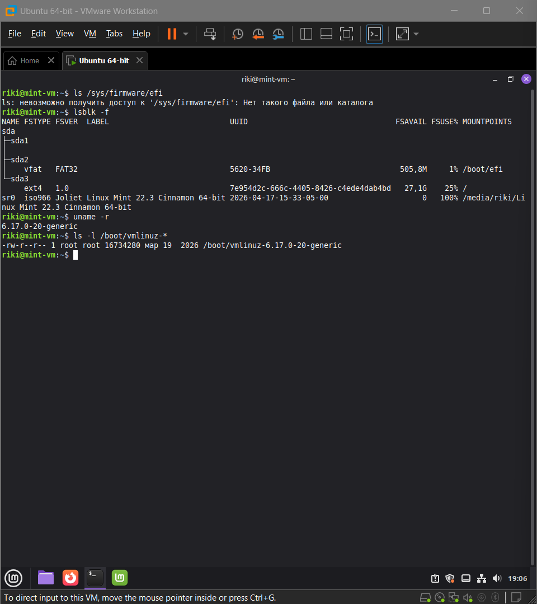

01-razvedka.md
ls: невозможно получить доступ к '/sys/firmware/efi': Нет такого файла или каталога
2. Структура диска
Выполнил команду:
Скопировать bash1
Вывод:
Скопировать 12
3
4
5
6
Таблица разделов:
Раздел
Файловая система
Точка монтирования
Назначение
sda1
(нет)
—
Служебный раздел (возможно, BIOS boot partition)
sda2
vfat (FAT32)
/boot/efi
ESP-раздел (хранилище загрузчика)
sda3
ext4
/
Корневой раздел (сама система)
sr0
iso9660
/media/riki/...
Виртуальный CD-привод с установочным образом (не используется)
Примечание: Раздел /boot/efi обычно ассоциируется с UEFI, но в VMware он может присутствовать и при BIOS-загрузке как артефакт установки. Основной загрузчик GRUB находится в /boot/grub/.
3. Версии ядра
Проверил текущее ядро:
Скопировать bash1
Вывод:
Скопировать 1Проверил все установленные ядра:
Скопировать bash1
Вывод:
Скопировать 1Вывод: Установлена только одна версия ядра — 6.17.0-20-generic. Это типично для свежей установки: дополнительные версии ядер появляются после обновлений системы.
