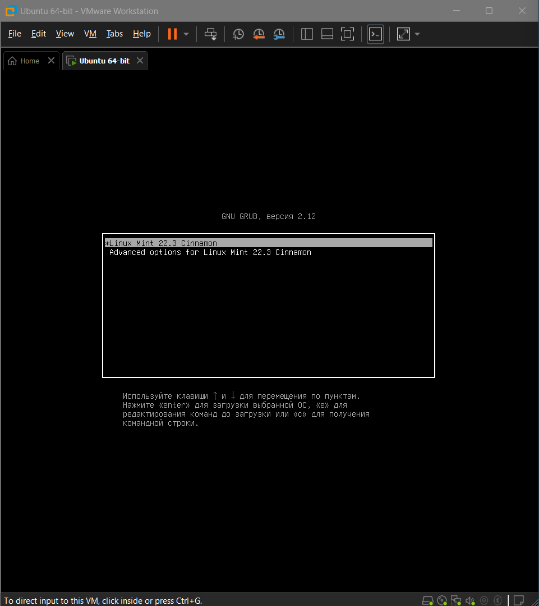
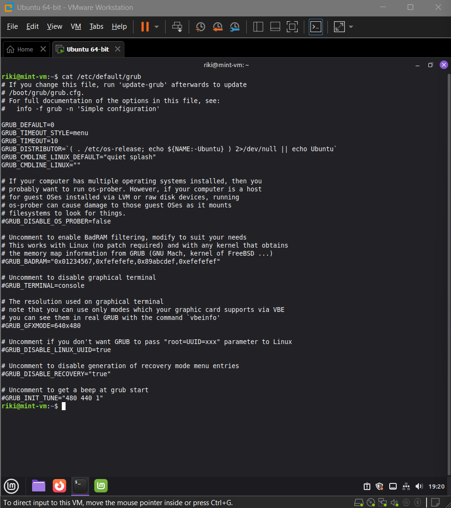

Если изменить /etc/default/grub, но забыть выполнить sudo update-grub, то при следующей перезагрузке ничего не изменится. Загрузчик GRUB при старте читает файл /boot/grub/grub.cfg, а не /etc/default/grub. Файл default/grub — это лишь исходник для генерации. Без команды update-grub рабочий файл grub.cfg останется старым, и система загрузится с прежними настройками (например, меню не появится или таймаут останется 5 секунд).
