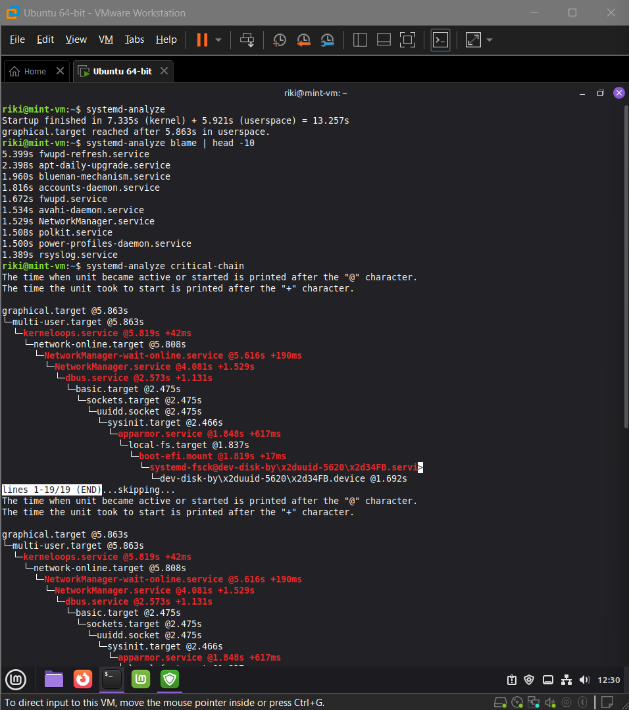

Вывод:Finished in 7.335s (kernel) + 5.921s (userspace) = 13.257s 
graphical.target reached after 5.863s in userspace.
Анализ: Полная загрузка системы заняла 13.257 секунды. Из них инициализация ядра (kernel) заняла 7.335с, а запуск пользовательских служб (userspace) — 5.921с. Графический интерфейс стал доступен через 5.863с после старта пользовательского пространства.
2. Самые медленные службы
Выполнил команду для получения рейтинга служб по времени запуска:systemd-analyze blame | head -10
вывод
5.399s fwupd-refresh.service
2.398s apt-daily-upgrade.service
1.960s blueman-mechanism.service
1.816s accounts-daemon.service
1.672s fwupd.service
1.534s avahi-daemon.service
1.529s NetworkManager.service
1.508s polkit.service
1.500s power-profiles-daemon.service
1.389s rsyslog.service
Топ-3 самых медленных службы: fwupd-refresh.service (5.399с) apt-daily-upgrade.service (2.398с) blueman-mechanism.service (1.960с) Предположение о причинах замедления: Служба fwupd-refresh.service занимается проверкой обновлений прошивок оборудования через интернет. Она может долго выполняться, если сетевое соединение ещё не установлено полностью или серверы отвечают с задержкой. Служба apt-daily-upgrade.service также выполняет фоновую проверку обновлений пакетов, что создаёт дополнительную нагрузку на диск и сеть в первые секунды после загрузки. 3. Критическая цепочка зависимостей Выполнил команду для анализа цепочки, определяющей общее время загрузки:systemd-analyze critical-chain
вывод
The time when unit became active or started is printed after the "@" character.
The time the unit took to start is printed after the "+" character.

graphical.target @5.863s
└─multi-user.target @5.863s
  └─kerneloops.service @5.819s +42ms
    └─network-online.target @5.808s
      └─NetworkManager-wait-online.service @5.616s +190ms
        └─NetworkManager.service @4.081s +1.529s
          └─dbus.service @2.573s +1.131s
            └─basic.target @2.475s
              └─sockets.target @2.475s
                └─uuidd.socket @2.475s
                  └─sysinit.target @2.466s
                    └─apparmor.service @1.848s +617ms
                      └─local-fs.target @1.837s
                        └─boot-efi.mount @1.819s +17ms
                          └─systemd-fsck@dev-disk-by\x2duuid-5620\x2d34FB.service @1.702s +108ms
                            └─dev-disk-by\x2duuid-5620\x2d34FB.device @1.692s
Анализ: Цепочка показывает, что достижение цели graphical.target (графический режим) напрямую зависит от network-online.target. Служба NetworkManager-wait-online.service принудительно задерживает дальнейшую загрузку на 190мс, ожидая полного поднятия сетевого интерфейса через NetworkManager.service. Это стандартное поведение, но на медленных сетях или при проблемах с DHCP эта задержка может быть значительно выше.
