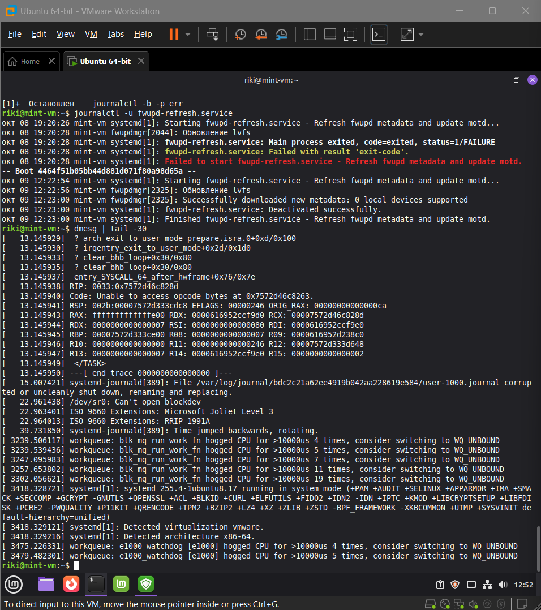

Задание 4. Чтение журналов
1. Ошибки текущей загрузки
2. Выполнил команду для поиска ошибок уровня err в текущей загрузке:

``bash journalctl -b -p err вывод окт 09 11:36:24 mint-vm kernel: piix4_smbus 0000:00:07.3: SMBus Host Controller not enabled! окт 09 11:36:29 mint-vm systemd[1]: Failed to start casper-md5check.service - casper-md5check Verify Live ISO checks окт 09 11:36:39 mint-vm kernel: /dev/sr0: Can't open blockdev окт 09 12:25:36 mint-vm cinnamon-screensaver-pam-helper[2347]: pam_ecryptfs: seteuid error **Анализ:** Критических ошибок, влияющих на работу системы, не обнаружено. Все найденные сообщения являются стандартными для виртуальной машины VMware:piix4_smbus: ядро не может найти физический контроллер SMBus, так как он эмулируется не полностью.casper-md5check и /dev/sr0: система пытается проверить контрольную сумму установочного образа Linux Mint на виртуальном CD-приводе (sr0), который уже неактивен.pam_ecryptfs: незначительная ошибка модуля PAM при работе экранной заставки Cinnamon. **2. Разбор сообщения конкретной службы** Взял для анализа службу fwupd-refresh.service, которая обновляет метаданные прошивок оборудования. journalctl -u fwupd-refresh.service вывод окт 08 19:20:28 mint-vm fwupdmgr[2044]: Обновление lvfs окт 08 19:20:28 mint-vm systemd[1]: fwupd-refresh.service: Main process exited, code=exited, status=1/FAILURE ... окт 09 12:22:56 mint-vm fwupdmgr[2325]: Обновление lvfs окт 09 12:23:00 mint-vm fwupdmgr[2325]: Successfully downloaded new metadata: 0 local devices supported окт 09 12:23:00 mint-vm systemd[1]: Finished fwupd-refresh.service - Refresh fwupd metadata and update motd. **Что это значит:** Служба fwupd пытается подключиться к серверу LVFS (Linux Vendor Firmware Service), чтобы проверить обновления BIOS и прошивок. В первой загрузке (08 окт) она завершилась с ошибкой (FAILURE), вероятно, из-за таймаута сети или отсутствия реального оборудования для обновления. Во второй загрузке (09 окт) служба отработала штатно: скачала метаданные и сообщила, что локальных устройств, требующих обновления, не найдено (0 local devices supported), что логично для виртуальной машины. **3. Разница между journalctl -b и journalctl -b -1** **journalctl -b** показывает журнал событий **текущей** загрузки (с момента последнего включения машины). Это полезно для диагностики проблем, которые происходят прямо сейчас. **journalctl -b -1`** показывает журнал предыдущей загрузки. Этот вариант критически важен, когда система неожиданно перезагрузилась, зависла или упала в kernel panic. Так как systemd сохраняет логи на диск, мы можем посмотреть, что именно происходило в системе до того, как она перестала отвечать, и найти причину сбоя.
