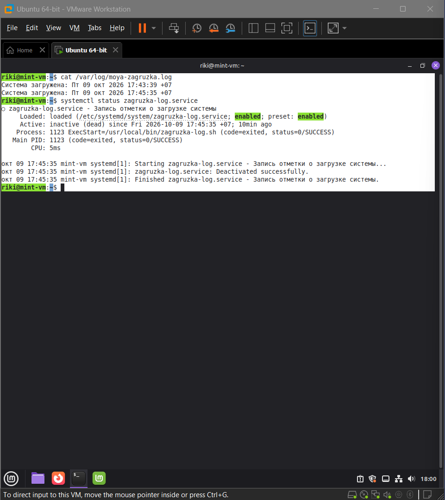

 Задание 5. Собственная служба systemd
 1. Создание скрипта
 2.  Создал исполняемый скрипт, который добавляет строку с текущей датой и временем в лог-файл:

``bash sudo nano /usr/local/bin/zagruzka-log.sh Содержимое скрипта  #!/bin/bash echo "Система загружена: $(date)" >> /var/log/moya-zagruzka.log Сделал скрипт исполняем  sudo chmod +x /usr/local/bin/zagruzka-log.sh **2. Создание файла юнита (службы)** Создал конфигурационный файл службы для systemd:sudo nano /etc/systemd/system/zagruzka-log.service Содержимое файла юнита:[Unit] Description=Запись отметки о загрузке системы After=multi-user.target [Service] Type=oneshot ExecStart=/usr/local/bin/zagruzka-log.sh [Install] WantedBy=multi-user.target **3. Включение и проверка службы** Перезагрузил конфигурацию systemd, включил автозапуск и запустил службу: sudo systemctl daemon-reload sudo systemctl enable zagruzka-log.service sudo systemctl start zagruzka-log.service Проверил статус службы: systemctl status zagruzka-log.service Вывод;  zagruzka-log.service - Запись отметки о загрузке системы      Loaded: loaded (/etc/systemd/system/zagruzka-log.service; enabled; preset: enabled)      Active: inactive (dead) since Fri 2026-10-09 17:45:35 +07; 10min ago     Process: 1123 ExecStart=/usr/local/bin/zagruzka-log.sh (code=exited, status=0/SUCCESS)    Main PID: 1123 (code=exited, status=0/SUCCESS)         CPU: 5ms окт 09 17:45:35 mint-vm systemd[1]: Starting zagruzka-log.service - Запись отметки о загрузке системы... окт 09 17:45:35 mint-vm systemd[1]: zagruzka-log.service: Deactivated successfully. окт 09 17:45:35 mint-vm systemd[1]: Finished zagruzka-log.service - Запись отметки о загрузке системы. __Примечание: Статус inactive (dead) является нормой для Type=oneshot, так как служба выполняет разовое действие и завершается сразу после его успешного выполнения.__ **4. Проверка после перезагрузки** Перезагрузил систему (sudo reboot) и проверил содержимое лог-файла:cat /var/log/moya-zagruzka.log Вывод  Система загружена: Пт 09 окт 2026 17:43:39 +07 Система загружена: Пт 09 окт 2026 17:45:35 +07 В файле появились две записи: первая от ручного запуска, вторая — от автоматического срабатывания службы при загрузке ОС. **5. Объяснение параметров юнита** **Type=oneshot**: указывает systemd, что это разовая задача. В отличие от типа simple (который предполагает постоянно работающий фоновый процесс), oneshot считается успешно запущенным только после завершения процесса ExecStart. После этого служба переходит в состояние inactive (dead), что корректно для скриптов, которые что-то делают и сразу выходят. **WantedBy=multi-user.target**: означает, что при выполнении команды systemctl enable будет создана символическая ссылка в директории /etc/systemd/system/multi-user.target.wants/. Это гарантирует, что служба будет запущена при достижении цели multi-user.target` (стандартный многопользовательский режим с сетью, аналог 3-го или 5-го runlevel в старых системах), то есть при обычной загрузке системы.
