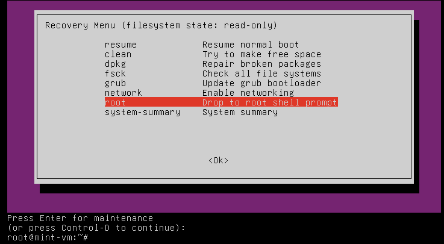
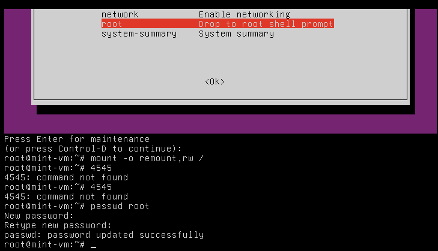
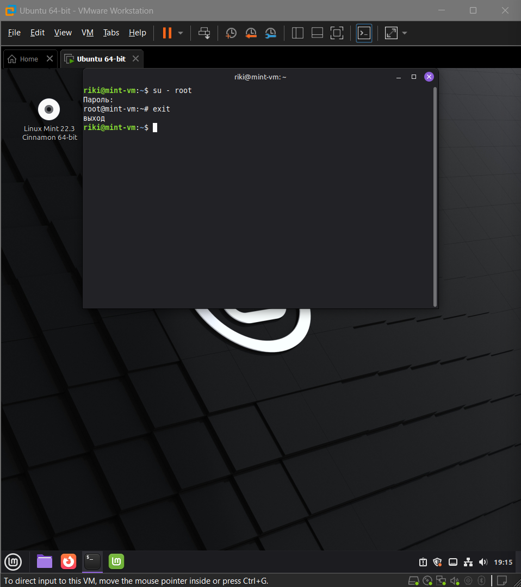

отчёт
Сброс пароля сработал, потому что загрузчик GRUB по умолчанию не защищён паролем. Любой, кто имеет физический (или консольный) доступ к машине, может отредактировать параметры ядра и запустить оболочку root в обход системы аутентификации. Не хватило двух механизмов защиты: пароля на редактирование GRUB и шифрования диска (LUKS).
